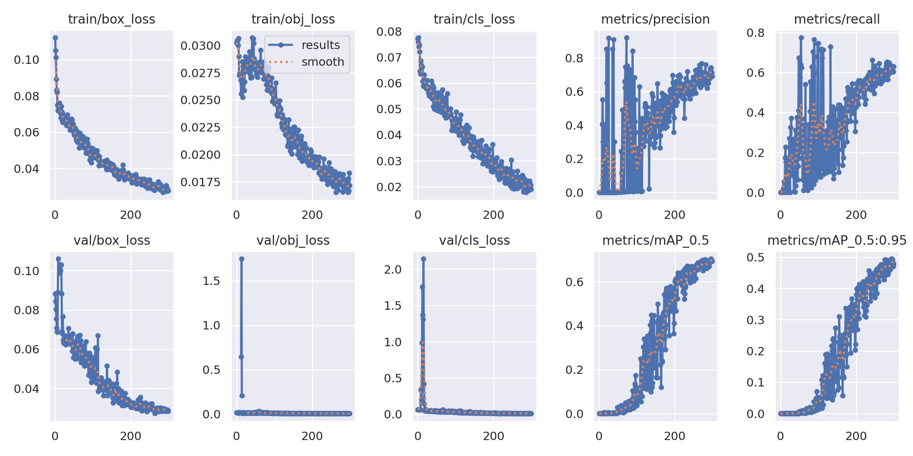

# 数据采集与深度学习模型训练
## 1.定义20类健身器材
(1)卷腹机​ - Abdominal Crunch Machine

(2)杠铃​ - Barbell

(3)卧推凳​ - Bench Press

(4)龙门架​ - Cable Crossover Machine 

(5)坐姿推胸机​ - Chest Press Machine

(6)椭圆机​ - Cross Trainer

(7)哑铃​ - Dumbbells

(8)哈克深蹲机		-hack squat machine

(9)臀部外展/内收机​ - Hip Abductor Adductor Machine

(10)动感单车​ - Indoor Cycling Bike

(11)壶铃​ - Kettlebell

(12)高位下拉器​ - Lat Pulldown Machine

(13)腿弯举机​ - Leg Curl Machine

(14)腿部推蹬机​ - Leg Press Machine

(15)划船机​ - Rowing Machine

(16)肩部推举机​ - Shoulder Press Machine

(17)史密斯机​ - Smith Machine

(18)登山机​ - Stair Climber

(19)跑步机​ - Treadmill

(20)瑜伽垫​ - Yoga Mat
## 2.数据采集
从网站上下载公开图片。
## 3.数据集划分
划分比例：训练集 (70%) : 验证集 (20%) : 测试集 (10%)。
## 4.数据标注
(1)工具选择：使用LabaelImg

(2)在https://github.com/HumanSignal/labelImg/releases中下载windows_v1.8.1.zip，之后解压该压缩包，解压完成后启动labelImg.exe文件打开标注软件。

(3)进入labelImg文件夹中的data文件夹中并打开.txt文件，然后删除原有的所有标签，以防止对之后的标注工作产生妨碍。

(4)选择open dir和对应的save dir。

(5)点击pascal VOC更改为YOLO，确保保存的格式为yolo格式。
## 5.模型版本选择
  选择YOLOv5s：《任务书》要求响应时间<2 秒，且系统最终可能部署在小程序云端或边缘设备，小模型推理速度更快，且精度通常能满足 85% 要求。
  下载yolov5s.pt(COCO 数据集预训练)，采用迁移学习加快收敛。
## 6.配置文件修改
### (1) 修改数据配置文件 (data.yaml)
```
# 数据集根目录路径 (绝对路径或相对于yolov5目录的路径)
path: /content/drive/MyDrive/dataset/fitness_equipment

# 子目录设置
train: images/train
val: images/val
test: images/test

# 类别数量
nc: 20

# 类别名称列表 (必须与 classes.txt 顺序一致)
names:
  0: Abdominal Crunch Machine
  1: Barbell
  2: Bench Press
  3: Cable Crossover Machine
  4: Chest Press Machine
  5: Cross Trainer
  6: Dumbbells
  7: Hack Squat Machine
  8: Hip Abductor Adductor Machine
  9: Indoor Cycling Bike
  10: Kettlebell
  11: Lat Pulldown Machine
  12: Leg Curl Machine
  13: Leg Press Machine
  14: Rowing Machine
  15: Shoulder Press Machine
  16: Smith Machine
  17: Stair Climber
  18: Treadmill
  19: Yoga Mat
```
### (2) Google colab上训练模型
```
!pip install ultralytics
!git clone https://github.com/ultralytics/yolov5  
!pip install -r /content/yolov5/requirements.txt
import torch
model = torch.hub.load('ultralytics/yolov5', 'yolov5s')
from google.colab import drive
drive.mount('/content/drive')
!python /content/yolov5/train.py --data /content/drive/MyDrive/dataset/fitness_equipment/data.yaml --epochs 300 --weights '' --cfg yolov5s.yaml --batch-size 64
```
训练结果如下：
```
300 epochs completed in 4.121 hours.
Optimizer stripped from yolov5/runs/train/exp/weights/last.pt, 14.5MB
Optimizer stripped from yolov5/runs/train/exp/weights/best.pt, 14.5MB

Validating yolov5/runs/train/exp/weights/best.pt...
Fusing layers... 
YOLOv5s summary: 157 layers, 7064065 parameters, 0 gradients, 15.9 GFLOPs
                 Class     Images  Instances          P          R      mAP50   mAP50-95: 100% 2/2 [00:06<00:00,  3.33s/it]
                   all        200        274      0.703      0.613      0.697      0.495
Abdominal Crunch Machine        200         10      0.383      0.312      0.391       0.28
               Barbell        200         15       0.67      0.467      0.527      0.306
           Bench Press        200         12          1      0.437      0.678      0.493
Cable Crossover Machine        200         10      0.675        0.5       0.64      0.494
   Chest Press Machine        200         10      0.382        0.6      0.555      0.423
         Cross Trainer        200         12      0.913       0.75      0.816      0.639
             Dumbbells        200         27       0.51      0.444       0.53      0.278
    Hack Squat Machine        200         10      0.512        0.9       0.85      0.601
Hip Abductor Adductor Machine        200         10      0.703      0.476      0.706      0.494
   Indoor Cycling Bike        200         10      0.944          1      0.995      0.746
            Kettlebell        200         49      0.895      0.698      0.842      0.538
  Lat Pulldown Machine        200          9       0.57      0.667      0.717      0.551
      Leg Curl Machine        200         10      0.592      0.727      0.711       0.59
     Leg Press Machine        200          9      0.799      0.556      0.771      0.553
        Rowing Machine        200          9      0.892      0.667      0.847      0.453
Shoulder Press Machine        200         10      0.587        0.6      0.534       0.41
         Smith Machine        200         10      0.525        0.6      0.603      0.451
         Stair Climber        200         10      0.858        0.7      0.803      0.663
             Treadmill        200         15      0.653      0.533      0.638       0.43
              Yoga Mat        200         17          1      0.633      0.787      0.509
Results saved to yolov5/runs/train/exp
```
### (3) 分析训练结果
a. 整体准确率偏低 (mAP50 = 69.7%)
	任务书明确要求"健身器材检测准确率不低于 85%"，当前 mAP50 仅为 69.7%，差距约 15.3%。
  
b. 精确率与召回率偏低
Precision (P) = 0.703：约30%的检测结果为误报
Recall (R) = 0.613：约39%的真实器材未被检测到

c. 类别间性能差异显著
	从各类别 mAP50 分析可见严重的不平衡：
  | 表现优秀 (mAP50 ≥ 80%) | 表现良好 (60% ≤ mAP50 < 80%) | 表现较差 (mAP50 < 60%) |
| --- | --- | --- |
| Cross Trainer 81.6% | Bench Press 67.8% Abdominal | Crunch Machin 39.1% |
| Hack Squat Machine | 85% Cable Crossover Machine 64% | Barbell 52.7% |
| Indoor Cycling Bike 99.5% | Hip Abductor Adductor Machine 70.6% | Chest Press Machine 55.5% |
| Kettlebell 84.2% | Lat Pulldown Machine 71.7% | Dumbbells 53% |
| Rowing Machine 84.7% | Leg Curl Machine 71.1% | Shoulder Press Machine 53.4% |
| Stair Climber 80.3% | Leg Press Machine 77.1% | ——  |
| ——  | Smith Machine 60.3% | ——  |
| ——  | Treadmill 63.8% | ——  |
| ——  | Yoga Mat 78.7% | ——  |
### (4)查看验证集损失

分析损失曲线：

①　Precision 和 Recall 均呈上升趋势，说明模型学习能力正常。

②　mAP_0.5曲线在250-300epoch时仍在上升没说明模型尚未完全收敛。

③　三项训练损失train/box_loss，train/obj_loss，train/cls_loss均呈现良好的下降趋势，说明模型正在有效学习特征。

④　val/obj_loss 和 val/cls_loss 在 第 1-2 epoch 后骤降至接近 0，这不符合正常训练规律。
	正常情况应与训练损失同步缓慢下降，可能原因：
  
a.验证集数据量过小（之前显示仅 200 张）

b.验证集标注质量有问题

c.学习率设置过大导致早期过拟合

d.数据预处理不一致

⑤　过拟合/欠拟合判断
| 判断依据 | 观察结果 | 结论  |
| --- | --- | --- |
| 训练损失vs验证损失 | 两者同步下降，差距较小 | 无明显过拟合 |
| mAP曲线趋势 | 300epoch时仍在上升 | 欠拟合（未完全收敛） |
| Precision/recall | 可继续训练 | 可继续训练 |

判断：模型处于欠拟合状态，建议增加训练轮数或优化数据质量。
### (5) 在kaggle上继续训练：GPU T4*2
```
!python /kaggle/working/yolov5/train.py \
    --data /kaggle/input/datasets/enkhuushhhh/fitness-dataset/fitness_equipment/data.yaml \
    --epochs 500 \
    --weights yolov5s.pt \
    --cfg yolov5s.yaml \
    --batch-size 32 \
    --img 640 \
    --hyp yolov5/data/hyps/hyp.scratch-high.yaml \
    --cache
```
关键调整：
|参数	|原值	|新值	|原因|
|----|----|----|----|
|--batch-size	|64	|32	|避免显存不足，梯度更稳定|
|--weights	|'' (从头训练)	|yolov5s.pt	|迁移学习，加快收敛|
|--epochs	|300	|500	|mAP曲线仍在上升，需更多轮数|
|--hyp	|默认	|hyp.scratch-high.yaml	|更强的数据增强|

训练结果：
```
500 epochs completed in 1.574 hours.
Optimizer stripped from yolov5/runs/train/exp/weights/last.pt, 14.5MB
Optimizer stripped from yolov5/runs/train/exp/weights/best.pt, 14.5MB

Validating yolov5/runs/train/exp/weights/best.pt...
Fusing layers... 
YOLOv5s summary: 157 layers, 7064065 parameters, 0 gradients, 15.9 GFLOPs
                 Class     Images  Instances          P          R      mAP50   
                   all        199        273      0.849      0.781      0.872      0.707
Abdominal Crunch Machine        199         10          1      0.599      0.911      0.688
               Barbell        199         15       0.86        0.6      0.609      0.412
           Bench Press        199         12        0.9      0.753      0.936      0.759
Cable Crossover Machine        199         10      0.737        0.8      0.871      0.675
   Chest Press Machine        199         10      0.769        0.5      0.632      0.558
         Cross Trainer        199         12      0.821      0.763      0.865      0.688
             Dumbbells        199         27      0.725      0.667       0.81      0.434
    Hack Squat Machine        199         10      0.905          1      0.995      0.874
Hip Abductor Adductor Machine        199         10      0.833          1      0.959      0.726
   Indoor Cycling Bike        199         10          1      0.985      0.995       0.87
            Kettlebell        199         49      0.951       0.79      0.928      0.751
  Lat Pulldown Machine        199          9      0.782      0.778      0.797      0.595
      Leg Curl Machine        199         10      0.671        0.9      0.922      0.824
     Leg Press Machine        199          9       0.75      0.778      0.926      0.824
        Rowing Machine        199          9       0.91      0.778      0.922       0.79
Shoulder Press Machine        199         10      0.776        0.8      0.833      0.731
         Smith Machine        199          9      0.784      0.778      0.901      0.743
         Stair Climber        199         10      0.942        0.8      0.896      0.728
             Treadmill        199         15      0.863      0.733      0.842      0.737
              Yoga Mat        199         17          1       0.81      0.884      0.738
Results saved to yolov5/runs/train/exp
```
### (6) 分析训练结果：与之前训练结果的对比
|指标	|第一次训练(300epochs)	|第二次训练(500epochs)	|提升幅度|
|----|----|----|---|
|mAP50	|69.7%	|87.2%	|+17.5% ✅|
|Precision	|70.3%	|84.9%	|+14.6% ✅|
|Recall	|61.3%	|78.1%	|+16.8% ✅|
|mAP50-95	|49.5%	|70.7%	|+21.2% ✅|
### (7) 响应时间测试
```
# 推理速度测试代码
import time
import torch

model = torch.hub.load('ultralytics/yolov5', 'custom', 
                       path='/kaggle/working/yolov5/runs/train/exp/weights/best.pt')

inference_times = []
for i in range(50):
    start = time.time()
    results = model('/kaggle/input/datasets/enkhuushhhh/fitness-dataset/fitness_equipment/images/test/1010.jpg')
    end = time.time()
    inference_times.append(end - start)

avg_time = sum(inference_times) / len(inference_times)
print(f"平均推理时间: {avg_time:.3f} 秒")
print(f"是否达标 (<2秒): {'✅ 是' if avg_time < 2 else '❌ 否'}")
```
测试结果：
```
平均推理时间: 0.039 秒
是否达标 (<2秒): ✅ 是
```
### (8) 推理detect.py
对于图片进行目标检测推理。
```
# 使用训练好的模型测试图片
!python /kaggle/working/yolov5/detect.py \
    --weights /kaggle/working/yolov5/runs/train/exp/weights/best.pt \
    --source /kaggle/input/datasets/enkhuushhhh/fitness-dataset/fitness_equipment/images/test \
    --conf-thres 0.7
```
--conf-thres 0.7：对应《需求规格说明书》中“置信度低于 70% 提示重试”的业务逻辑。
### (9) 导出模型export.py
部署优化：.pt 文件依赖 PyTorch 环境，较重。导出为 ONNX 格式后，可以在更多平台（如 Java 后端、C++ 服务）运行，且推理速度可能更快，有助于满足《任务书》的**<2 秒响应时间**指标。

跨平台兼容：如果您后续打算将模型部署到非 Python 环境，此步骤必不可少。
```
# 导出为 ONNX 格式
!python /kaggle/working/yolov5/export.py \
    --weights /kaggle/working/yolov5/runs/train/exp/weights/best.pt \
    --include onnx \
    --imgsz 640
```
### (10)验证val.py
功能：在指定的验证集或测试集上评估模型性能，计算 mAP、Precision、Recall 等指标。

项目中的作用：
	*论文数据支撑：毕业论文“实验结果分析”章节需要的混淆矩阵、PR 曲线、mAP 表格，主要通过此脚本生成。
	*最终指标验证：训练过程中的 mAP 是实时估算的，使用 val.py 对独立测试集进行评估，能得到更权威的准确率数据，用于证明是否达到《任务书》≥85% 的要求。
```
# 在测试集上验证模型
!python /kaggle/working/yolov5/val.py \
    --data /kaggle/input/datasets/enkhuushhhh/fitness-dataset/fitness_equipment/data.yaml \
    --weights /kaggle/working/yolov5/runs/train/exp/weights/best.pt \
    --batch-size 32
```
验证结果：
```
Class     Images  Instances          P          R      mAP50   
                   all        199        273      0.829      0.793      0.864      0.698
Abdominal Crunch Machine        199         10      0.893        0.7      0.911      0.687
               Barbell        199         15       0.85        0.6      0.609      0.424
           Bench Press        199         12      0.908      0.833      0.927      0.759
Cable Crossover Machine        199         10      0.747      0.889      0.843      0.612
   Chest Press Machine        199         10      0.751        0.5      0.627      0.554
         Cross Trainer        199         12      0.822      0.773       0.84      0.646
             Dumbbells        199         27       0.76      0.705      0.822      0.441
    Hack Squat Machine        199         10       0.83          1      0.995      0.858
Hip Abductor Adductor Machine        199         10      0.823          1       0.95      0.739
   Indoor Cycling Bike        199         10      0.975          1      0.995      0.871
            Kettlebell        199         49      0.954      0.844      0.926      0.748
  Lat Pulldown Machine        199          9      0.721      0.778      0.773      0.591
      Leg Curl Machine        199         10      0.654        0.9      0.913       0.81
     Leg Press Machine        199          9      0.817      0.778      0.931      0.828
        Rowing Machine        199          9      0.882      0.778      0.925      0.792
Shoulder Press Machine        199         10      0.751        0.8      0.836      0.722
         Smith Machine        199          9      0.669      0.675      0.871      0.722
         Stair Climber        199         10      0.932        0.8      0.888      0.723
             Treadmill        199         15      0.837      0.686       0.82       0.71
              Yoga Mat        199         17          1      0.822      0.884      0.732
Speed: 0.4ms pre-process, 6.8ms inference, 3.3ms NMS per image at shape (32, 3, 640, 640)
Results saved to yolov5/runs/val/exp2
```
